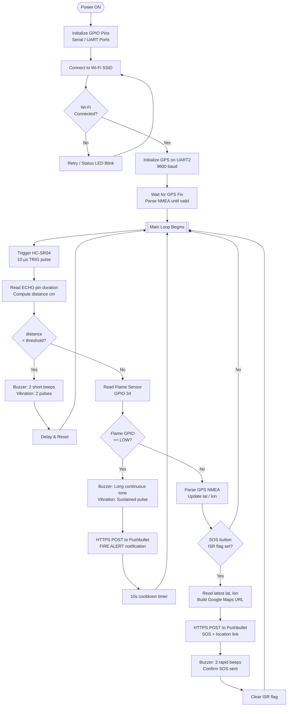
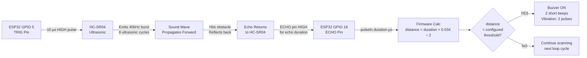
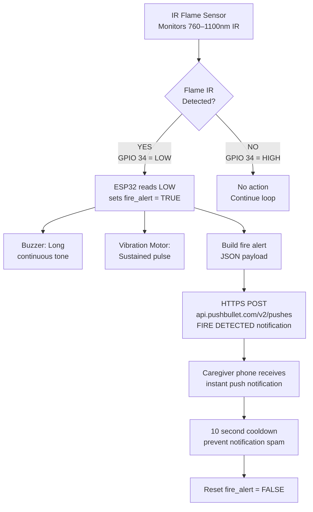

# Multi-Sensor Safety Stick — System Architecture

> Detailed system architecture, component interactions, data flows, and operational logic diagrams for the Smart Stick IoT assistive device.

---

## Table of Contents

- [High-Level System Overview](#high-level-system-overview)
- [Hardware Architecture](#hardware-architecture)
- [Firmware Architecture](#firmware-architecture)
- [Communication Architecture](#communication-architecture)
- [Main Program Flow](#main-program-flow)
- [Obstacle Detection Flow](#obstacle-detection-flow)
- [Fire Detection Flow](#fire-detection-flow)
- [SOS Emergency Alert Flow](#sos-emergency-alert-flow)
- [GPS Data Flow](#gps-data-flow)
- [Module Interaction Diagram](#module-interaction-diagram)
- [System Integration & Testing Methodology](#system-integration--testing-methodology)

---

## High-Level System Overview

The Smart Stick is organized into four functional layers:

```
┌─────────────────────────────────────────────────────────────────────┐
│                        PERCEPTION LAYER                             │
│   ┌──────────────┐  ┌──────────────┐  ┌──────────────┐             │
│   │  HC-SR04     │  │    Flame     │  │   NEO-6M     │             │
│   │  Ultrasonic  │  │   Sensor     │  │  GPS Module  │             │
│   │  (Obstacles) │  │   (Fire IR)  │  │  (Location)  │             │
│   └──────┬───────┘  └──────┬───────┘  └──────┬───────┘             │
└──────────┼────────────────┼───────────────────┼─────────────────────┘
           │                │                   │
           ▼                ▼                   ▼
┌─────────────────────────────────────────────────────────────────────┐
│               PROCESSING LAYER — ESP32 Microcontroller              │
│                                                                     │
│   ┌─────────────────────────────────────────────────────────────┐   │
│   │                   Firmware Logic Loop                       │   │
│   │  Distance Calc │ Fire State Read │ NMEA Parser │ SOS ISR    │   │
│   └──────────────────────────┬──────────────────────────────────┘   │
│                              │                                      │
│   ┌──────────────────────────▼──────────────────────────────────┐   │
│   │          Wi-Fi Stack — HTTPClient + WiFiClientSecure        │   │
│   │       (Pushbullet API over HTTPS / Google Maps URL)         │   │
│   └─────────────────────────────────────────────────────────────┘   │
└─────────────────────────────────────────────────────────────────────┘
           │                              │
           ▼                              ▼
┌───────────────────────┐   ┌────────────────────────────────────────┐
│    FEEDBACK LAYER     │   │           CLOUD / ALERT LAYER          │
│                       │   │                                        │
│  ┌─────────────────┐  │   │  ┌──────────────────┐                  │
│  │     Buzzer      │  │   │  │  Pushbullet API  │                  │
│  │  (Auditory)     │  │   │  │  api.pushbullet  │                  │
│  └─────────────────┘  │   │  │  .com/v2/pushes  │                  │
│  ┌─────────────────┐  │   │  └────────┬─────────┘                  │
│  │ Vibration Motor │  │   │           │                            │
│  │  (Haptic)       │  │   │           ▼                            │
│  └─────────────────┘  │   │  ┌──────────────────────┐             │
│  ┌─────────────────┐  │   │  │  Caregiver Smartphone │             │
│  │   SOS Button    │  │   │  │  (Push Notification + │             │
│  │  (User Input)   │  │   │  │   Google Maps Link)   │             │
│  └─────────────────┘  │   │  └──────────────────────┘             │
└───────────────────────┘   └────────────────────────────────────────┘
```

---

## Hardware Architecture

### ESP32 GPIO Pin Mapping

| GPIO Pin | Connected To | Direction | Protocol / Mode |
|---|---|---|---|
| GPIO 5 | HC-SR04 TRIG | OUTPUT | Digital pulse (10 μs HIGH) |
| GPIO 18 | HC-SR04 ECHO | INPUT | Digital time-of-flight measure |
| GPIO 34 | Flame Sensor OUT | INPUT | Digital (LOW = fire detected) |
| GPIO 16 (RX2) | NEO-6M GPS TX | INPUT | UART2 @ 9600 baud |
| GPIO 17 (TX2) | NEO-6M GPS RX | OUTPUT | UART2 @ 9600 baud |
| GPIO 27 | SOS Push Button | INPUT_PULLUP + INT | Falling edge hardware interrupt |
| GPIO 25 | Buzzer (via NPN transistor) | OUTPUT | Digital / PWM Tone |
| GPIO 26 | Vibration Motor (via NPN) | OUTPUT | Digital / PWM |
| 3V3 / GND | All sensor VCC / GND | POWER | Power rail |

### Power Supply Chain

```
[Li-Po Battery 3.7V / 2000mAh]
          │
          ▼
[TP4056 Charger + Protection Circuit]
          │
          ▼
[MT3608 Boost Converter → 5V]
     │              │
     ▼              ▼
[ESP32 VIN 5V]   [Buzzer 5V via NPN transistor]
     │           [Vibration Motor 5V via NPN transistor]
     ▼
[ESP32 3V3 rail → HC-SR04 VCC, Flame Sensor VCC, NEO-6M VCC]
```

---

## Firmware Architecture

### Module Structure

```
firmware/
├── main.ino                    # Entry: setup(), loop()
├── sensors/
│   ├── ultrasonic.cpp          # HC-SR04: triggerPulse(), readDistance()
│   ├── flame.cpp               # Flame sensor GPIO read + state mgmt
│   └── gps.cpp                 # TinyGPS++ NMEA parser wrapper
├── actuators/
│   ├── buzzer.cpp              # Tone pattern functions per event type
│   └── vibration.cpp           # Haptic motor PWM control
├── connectivity/
│   ├── wifi_manager.cpp        # Wi-Fi connect / auto-reconnect logic
│   └── pushbullet.cpp          # HTTPS POST to Pushbullet API
├── sos/
│   └── sos_handler.cpp         # Button ISR, debounce, alert dispatch
└── config.h                    # Pin defs, thresholds, API keys, SSID
```

### Firmware State Machine

```
              ┌──────────────────────┐
              │      BOOT / INIT     │
              │  Wi-Fi Connect       │
              │  GPS UART Init       │
              │  GPIO Pin Setup      │
              │  Attach SOS ISR      │
              └──────────┬───────────┘
                         │
                         ▼
              ┌──────────────────────┐
          ┌──▶│    IDLE / SCANNING   │◀──────────────────────┐
          │   │     (main loop)      │                       │
          │   └──────────┬───────────┘                       │
          │              │                                    │
          │   ┌──────────┼──────────────┐                    │
          │   ▼          ▼              ▼                    │
          │ [Ultrasonic] [Flame Sensor] [GPS Read]           │
          │   │          │              │                    │
          │ dist <    fire_pin       coords                  │
          │ thresh?   == LOW?        updated                  │
          │   │          │                                    │
          │   ▼          ▼                                    │
          │ ┌───────────────────────┐                        │
          │ │     ALERT STATE       │                        │
          │ │  Buzzer Pattern ON    │                        │
          │ │  Vibration Motor ON   │                        │
          │ └───────────────────────┘                        │
          │         │                                        │
          │   [Fire?]──Yes──▶ Pushbullet FIRE ALERT          │
          │         │                                        │
          │   [SOS?]──Yes──▶ GPS Coords ──▶ Pushbullet SOS  │
          │         │                                        │
          └── clear alerts ────────────────────────────────┘
```

---

## Communication Architecture

```
┌──────────────────────────────────────────────────────────────────┐
│                   ESP32 Communication Interfaces                  │
│                                                                  │
│  UART2 (RX:GPIO16, TX:GPIO17) ──────▶  NEO-6M GPS (NMEA 9600b) │
│                                                                  │
│  GPIO INPUT (34) ───────────────────▶  Flame Sensor OUT         │
│                                                                  │
│  GPIO OUT/IN (5/18) ────────────────▶  HC-SR04 TRIG / ECHO      │
│                                                                  │
│  GPIO INT (27, INPUT_PULLUP) ───────▶  SOS Push Button          │
│                                                                  │
│  GPIO OUT (25) ─────────────────────▶  Buzzer (via NPN BC547)   │
│                                                                  │
│  GPIO OUT (26) ─────────────────────▶  Vib. Motor (via NPN)     │
│                                                                  │
│  Wi-Fi 802.11 b/g/n (onboard) ──────▶  Home Router / Hotspot   │
│                                                │                 │
│                                         Internet (HTTPS/TLS)    │
│                                                │                 │
│                                    api.pushbullet.com            │
│                                                │                 │
│                                   Caregiver's Smartphone App    │
└──────────────────────────────────────────────────────────────────┘
```

---

## Main Program Flow



---

## Obstacle Detection Flow



---

## Fire Detection Flow



---

## SOS Emergency Alert Flow

```mermaid
sequenceDiagram
    participant U as User
    participant BTN as SOS Button (GPIO 27)
    participant ISR as ESP32 ISR
    participant LOOP as ESP32 Main Loop
    participant GPS as NEO-6M Module
    participant API as Pushbullet API
    participant CG as Caregiver's Phone

    U->>BTN: Presses SOS button
    BTN->>ISR: GPIO Falling Edge Interrupt fires
    ISR->>LOOP: Set sos_flag = true (IRAM_ATTR)
    LOOP->>GPS: Read latest lat, lon from TinyGPS++
    GPS-->>LOOP: lat=18.7521, lon=77.2034
    LOOP->>LOOP: Build URL:\nmaps.google.com/?q=18.7521,77.2034
    LOOP->>API: HTTPS POST /v2/pushes\n{title: "SOS!", body: "Help! Location: <url>"}
    API-->>LOOP: HTTP 200 OK
    LOOP->>LOOP: Buzzer: 3 rapid beeps\nConfirm SOS sent
    LOOP->>LOOP: Clear sos_flag = false
    API->>CG: Push notification delivered instantly
    CG->>CG: Tap notification → Google Maps\nopens at user's exact location
```

---

## GPS Data Flow

```mermaid
flowchart LR
    A[GPS Satellites\n4+ in view] -->|L1 frequency\n1575.42 MHz| B[NEO-6M\nGPS Module]
    B -->|NMEA sentences\n$GPGGA, $GPRMC\nUART 9600 baud| C[ESP32 UART2\nRX GPIO 16]
    C -->|gps.encode char| D[TinyGPS++\nLibrary Parser]
    D -->|gps.location.lat\ngps.location.lng| E[float lat, lon\nin ESP32 RAM]
    E -->|On SOS event| F[URL Constructor]
    F -->|https://maps.google.com/?q=lat,lon| G[Pushbullet\nNotification Body]
    G -->|HTTPS POST| H[Caregiver Phone\nGoogle Maps link]
```



---

## Module Interaction Diagram

```
                    ┌──────────────────────────────────┐
                    │            ESP32                 │
                    │                                  │
  HC-SR04 ──────────┤ GPIO 5 (TRIG) / GPIO 18 (ECHO)  │
  Flame Sensor ─────┤ GPIO 34 (Digital IN)             │
  NEO-6M GPS ───────┤ GPIO 16 RX2 / GPIO 17 TX2 UART  │
  SOS Button ────── ┤ GPIO 27 (Interrupt, PULLUP)      │
  Buzzer ───────────┤ GPIO 25 (PWM OUT via BC547 NPN)  │
  Vibration Motor ──┤ GPIO 26 (PWM OUT via BC547 NPN)  │
  Wi-Fi Antenna ────┤ Onboard PCB antenna              │
  Power In ─────────┤ VIN 5V / 3V3 / GND              │
                    └────────────────┬─────────────────┘
                                     │
                               Wi-Fi 802.11 b/g/n
                                     │
                          [Home Router / Mobile Hotspot]
                                     │
                                  Internet
                                     │
                         [api.pushbullet.com HTTPS]
                                     │
                       [Caregiver Smartphone — Pushbullet App]
                                     │
                          [Google Maps GPS Location Link]
```

---

## System Integration & Testing Methodology

As defined in the project's methodology, the system was developed and tested through the following phases:

**1. Planning & Hardware Configuration**
Identified all hardware components, defined GPIO pin assignments, established power supply chain from Li-Po battery through boost converter to ESP32 and peripherals.

**2. Firmware Development**
Developed using Arduino IDE in C/C++. Implemented sensor polling loop, ISR for SOS button, TinyGPS++ NMEA parsing, and Pushbullet HTTPS client.

**3. Sensor Calibration & Validation**
Calibrated obstacle detection threshold distances. Validated flame sensor sensitivity range. Confirmed GPS NMEA parsing accuracy against known coordinates.

**4. Integration & Verification**
Integrated all modules, conducted end-to-end tests including:
- Walk-test with obstacles at various distances verifying buzzer trigger accuracy.
- Fire detection test confirming Pushbullet notification delivery time.
- SOS button test verifying GPS coordinates in notification link.

**5. User Interface (Companion App)**
Developed caregiver companion app using MIT App Inventor and Pushbullet API for real-time location monitoring.

**6. Performance Tuning**
Optimized sensor polling intervals and Wi-Fi reconnection logic to balance responsiveness with power consumption.

---

## Summary of All Data Paths

| Source | Data | Protocol | Destination | Triggered Action |
|---|---|---|---|---|
| HC-SR04 | Distance (cm) | GPIO pulse timing | ESP32 RAM | Buzzer + Vibration if < threshold |
| Flame Sensor | Binary fire / no-fire | GPIO digital LOW/HIGH | ESP32 RAM | Buzzer + Vibration + Pushbullet FIRE |
| NEO-6M GPS | Latitude, Longitude | UART NMEA sentences | TinyGPS++ → ESP32 RAM | Used in SOS Google Maps URL |
| SOS Button | Button press event | GPIO hardware interrupt | ISR flag → main loop | Pushbullet SOS + GPS link |
| ESP32 Wi-Fi | HTTPS POST JSON | Wi-Fi → Internet → TLS | Pushbullet API | Push notification to caregiver |
| Pushbullet API | Push notification | Internet → App | Caregiver smartphone | Alert + Maps link displayed |