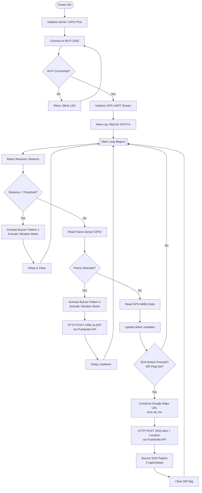
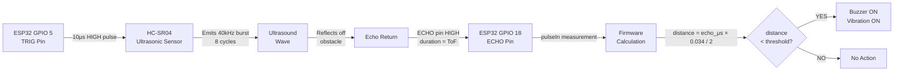
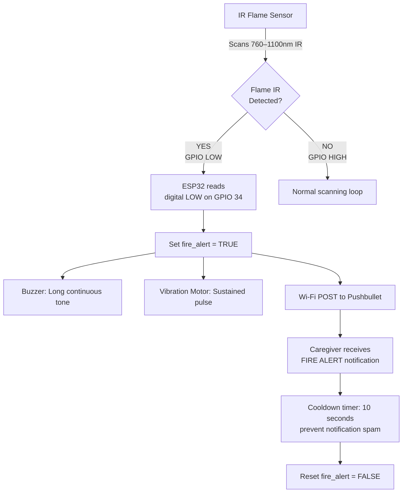
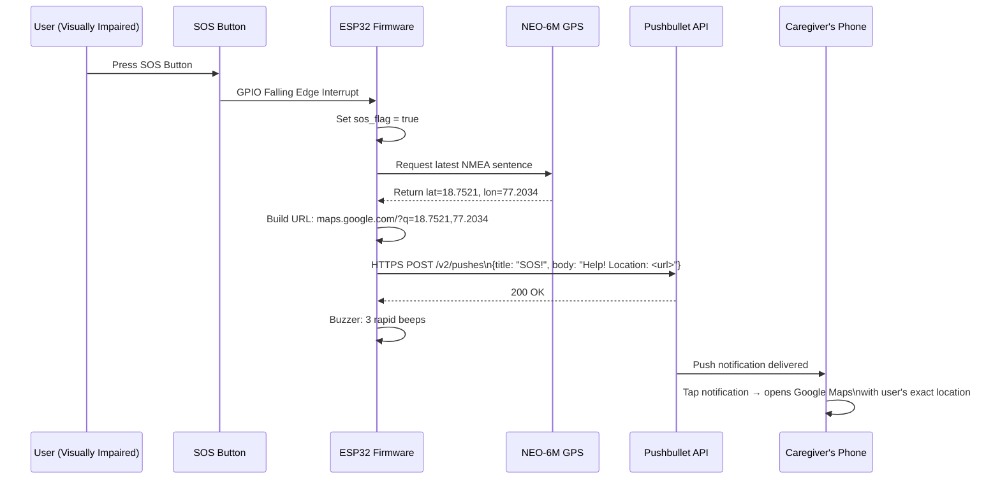

# Multi-Sensor Safety Stick — Architecture

> Detailed system architecture, component wiring, data flow, and operational logic for the Multi-Sensor Safety Stick IoT assistive device.

---

## Table of Contents

- [High-Level System Architecture](#high-level-system-architecture)
- [Hardware Architecture](#hardware-architecture)
- [Firmware Architecture](#firmware-architecture)
- [Communication Architecture](#communication-architecture)
- [Main Program Flow](#main-program-flow)
- [Interrupt & Event Flow](#interrupt--event-flow)
- [Obstacle Detection Flow](#obstacle-detection-flow)
- [Fire Detection Flow](#fire-detection-flow)
- [SOS Alert Flow](#sos-alert-flow)
- [GPS Data Flow](#gps-data-flow)
- [Component Interconnection Map](#component-interconnection-map)

---

## High-Level System Architecture

The system is organized into four layers:

```
┌─────────────────────────────────────────────────────────────────────┐
│                        PERCEPTION LAYER                             │
│   ┌──────────────┐  ┌──────────────┐  ┌──────────────┐             │
│   │  Ultrasonic  │  │    Flame     │  │   NEO-6M     │             │
│   │   Sensor     │  │   Sensor     │  │  GPS Module  │             │
│   │  (HC-SR04)   │  │  (IR-based)  │  │  (UART/NMEA) │             │
│   └──────┬───────┘  └──────┬───────┘  └──────┬───────┘             │
└──────────┼────────────────┼───────────────────┼─────────────────────┘
           │                │                   │
           ▼                ▼                   ▼
┌─────────────────────────────────────────────────────────────────────┐
│                    PROCESSING LAYER (ESP32)                         │
│                                                                     │
│   ┌──────────────────────────────────────────────────────────────┐  │
│   │                    Firmware Logic Loop                       │  │
│   │                                                              │  │
│   │   Distance Calc  │  Fire State   │  NMEA Parser  │  SOS ISR │  │
│   │   (echo timing)  │  (GPIO read)  │  (TinyGPS++)  │  (button)│  │
│   └──────────────────┬──────────────────────────────────────────┘  │
│                      │                                              │
│   ┌──────────────────▼─────────────────────────┐                  │
│   │           Wi-Fi / HTTPS Stack              │                  │
│   │    (Pushbullet API client, Google Maps URL) │                  │
│   └────────────────────────────────────────────┘                  │
└─────────────────────────────────────────────────────────────────────┘
           │                │
           ▼                ▼
┌───────────────────┐  ┌─────────────────────────────────────────────┐
│   FEEDBACK LAYER  │  │              CLOUD / ALERT LAYER             │
│                   │  │                                              │
│  ┌─────────────┐  │  │  ┌─────────────────┐  ┌──────────────────┐  │
│  │   Buzzer    │  │  │  │ Pushbullet API  │  │   Google Maps    │  │
│  │  (Auditory) │  │  │  │ (Push to phone) │  │  (GPS link URL)  │  │
│  └─────────────┘  │  │  └────────┬────────┘  └──────────────────┘  │
│  ┌─────────────┐  │  │           │                                  │
│  │  Vibration  │  │  │           ▼                                  │
│  │   Motor     │  │  │  ┌────────────────────┐                      │
│  │  (Haptic)   │  │  │  │  Caregiver's Phone │                      │
│  └─────────────┘  │  │  │  (Notification)    │                      │
└───────────────────┘  │  └────────────────────┘                      │
                       └─────────────────────────────────────────────┘
```

---

## Hardware Architecture

### ESP32 GPIO Pin Mapping

| GPIO Pin | Connected To | Direction | Protocol |
|---|---|---|---|
| GPIO 5 | HC-SR04 TRIG | OUTPUT | Digital PWM |
| GPIO 18 | HC-SR04 ECHO | INPUT | Digital (time-of-flight) |
| GPIO 34 | Flame Sensor OUT | INPUT | Digital (active LOW) |
| GPIO 16 (RX2) | NEO-6M TX | INPUT | UART (9600 baud) |
| GPIO 17 (TX2) | NEO-6M RX | OUTPUT | UART (9600 baud) |
| GPIO 27 | SOS Push Button | INPUT_PULLUP | Digital Interrupt |
| GPIO 25 | Buzzer | OUTPUT | Digital PWM / Tone |
| GPIO 26 | Vibration Motor | OUTPUT | Digital PWM |
| 3.3V / GND | All sensors VCC/GND | POWER | Power rail |

### Power Architecture

```
┌──────────────────────────────────────────────────────────┐
│                    Power Supply Chain                    │
│                                                          │
│  [Li-Po Battery 3.7V / 2000mAh]                         │
│         │                                               │
│         ▼                                               │
│  [TP4056 Battery Charger + Protection Circuit]           │
│         │                                               │
│         ▼                                               │
│  [MT3608 Boost Converter → 5V]                          │
│         │                                               │
│    ┌────┴────┐                                          │
│    ▼         ▼                                          │
│ [ESP32   ] [HC-SR04] (both at 3.3V via ESP32 3v3 pin)  │
│ [NEO-6M  ] → 3.3V directly                              │
│ [Buzzer  ] → 5V via NPN transistor driver               │
│ [Vib.Motor] → 5V via NPN transistor driver              │
└──────────────────────────────────────────────────────────┘
```

---

## Firmware Architecture

### Module Breakdown

```
firmware/
├── main.ino                  # Entry point, setup(), loop()
├── sensors/
│   ├── ultrasonic.cpp        # HC-SR04 driver (triggerPulse, readDistance)
│   ├── flame.cpp             # Flame sensor GPIO read, state management
│   └── gps.cpp               # TinyGPS++ wrapper, NMEA parsing
├── actuators/
│   ├── buzzer.cpp            # Tone patterns for different events
│   └── vibration.cpp         # Haptic motor PWM control
├── connectivity/
│   ├── wifi_manager.cpp      # Wi-Fi connect, reconnect logic
│   └── pushbullet.cpp        # HTTPS POST to Pushbullet API
├── sos/
│   └── sos_handler.cpp       # SOS button ISR, debounce, alert dispatch
└── config.h                  # Thresholds, API keys, pin definitions
```

### Firmware State Machine

```
                  ┌─────────────────┐
                  │   BOOT / INIT   │
                  │  Wi-Fi Connect  │
                  │  GPS Warm-up    │
                  └────────┬────────┘
                           │
                           ▼
                  ┌─────────────────┐
              ┌──▶│   IDLE/SCANNING  │◀──────────────────┐
              │   │  (main loop)    │                    │
              │   └────────┬────────┘                    │
              │            │                             │
              │     ┌──────┼──────────────┐              │
              │     ▼      ▼              ▼              │
              │  [Ultrasonic] [Flame]  [GPS Read]        │
              │     │      │              │              │
              │  dist<     fire_pin      coords         │
              │  thresh?   = LOW?        updated         │
              │     │      │                             │
              │     ▼      ▼                             │
              │  ┌──────────────────┐                    │
              │  │  ALERT STATE     │                    │
              │  │ Buzzer ON        │                    │
              │  │ Vibrate ON       │                    │
              │  └──────────────────┘                    │
              │            │                             │
              │     [Fire?]─Yes──▶ Pushbullet FIRE Alert │
              │            │                             │
              │     [SOS?]─Yes──▶ Pushbullet SOS + GPS   │
              │            │                             │
              └────── clear state ──────────────────────┘
```

---

## Communication Architecture

```
┌─────────────────────────────────────────────────────────────────┐
│                     ESP32 Communication Interfaces               │
│                                                                 │
│  UART2 (RX:16, TX:17)                                          │
│  ─────────────────────▶  NEO-6M GPS (NMEA @ 9600 baud)         │
│                                                                 │
│  GPIO Digital In (34)                                           │
│  ─────────────────────▶  Flame Sensor Output                    │
│                                                                 │
│  GPIO Digital Out (5) / In (18)                                 │
│  ─────────────────────▶  HC-SR04 TRIG / ECHO                    │
│                                                                 │
│  GPIO Interrupt (27)                                            │
│  ─────────────────────▶  SOS Push Button                        │
│                                                                 │
│  Wi-Fi 802.11 b/g/n                                             │
│  ─────────────────────▶  Home Router / Hotspot                  │
│                               │                                 │
│                               ▼                                 │
│                    Internet (HTTPS / TLS)                        │
│                               │                                 │
│                               ▼                                 │
│                    api.pushbullet.com                           │
│                               │                                 │
│                               ▼                                 │
│                    Caregiver Smartphone App                     │
└─────────────────────────────────────────────────────────────────┘
```

---

## Main Program Flow



---

## Interrupt & Event Flow

The SOS button is handled via a hardware interrupt (ISR) so it is never missed even while the main loop is busy:

```
GPIO 27 (INPUT_PULLUP)
         │
         │  [Button Press — falling edge]
         │
         ▼
  ┌──────────────────┐
  │  ISR Triggered   │  (runs in <1 μs interrupt context)
  │  sos_flag = true │
  └──────────────────┘
         │
         ▼ (next main loop cycle)
  ┌──────────────────────────────────┐
  │  Main Loop checks sos_flag       │
  │  if (sos_flag) {                 │
  │      get GPS coords;             │
  │      build map URL;              │
  │      call pushbullet();          │
  │      buzz SOS pattern();         │
  │      sos_flag = false;           │
  │  }                               │
  └──────────────────────────────────┘
```

---

## Obstacle Detection Flow



---

## Fire Detection Flow



---

## SOS Alert Flow



---

## GPS Data Flow

```mermaid
flowchart LR
    A[GPS Satellites\n4+ in view] -->|L1 frequency\n1575.42 MHz signals| B[NEO-6M\nGPS Module]
    B -->|NMEA sentences\n$GPGGA, $GPRMC\nUART 9600 baud| C[ESP32 Serial2\nRX GPIO 16]
    C -->|TinyGPS++\n.encode char-by-char| D[TinyGPS++\nParser]
    D -->|gps.location.lat\ngps.location.lng| E[float lat, lon\nvariables in RAM]
    E -->|On SOS event| F[URL Builder\nString concat]
    F -->|https://maps.google.com/?q=lat,lon| G[Pushbullet Notification\nBody Text]
```



---

## Component Interconnection Map

```
                        ┌─────────────────────────────────┐
                        │            ESP32                │
                        │                                 │
  HC-SR04 ──────────────│ GPIO 5 (TRIG) / GPIO 18 (ECHO) │
                        │                                 │
  Flame Sensor ─────────│ GPIO 34 (Digital IN)            │
                        │                                 │
  NEO-6M GPS ───────────│ GPIO 16 (UART RX2)              │
                        │ GPIO 17 (UART TX2)              │
                        │                                 │
  SOS Button ───────────│ GPIO 27 (INT, PULLUP)           │
                        │                                 │
  Buzzer ───────────────│ GPIO 25 (PWM OUT)               │
                        │                                 │
  Vibration Motor ──────│ GPIO 26 (PWM OUT)               │
                        │                                 │
  Wi-Fi Antenna ────────│ (Onboard PCB antenna)           │
                        │                                 │
  Power In ─────────────│ VIN (5V) / 3V3 / GND           │
                        └─────────────────────────────────┘
                                       │
                                  Wi-Fi 802.11
                                       │
                               [Home Router / Hotspot]
                                       │
                                    Internet
                                       │
                            [api.pushbullet.com]
                                       │
                         [Caregiver's Smartphone App]
```

---

## Summary of Data Paths

| Source | Data Type | Protocol | Destination | Action |
|---|---|---|---|---|
| HC-SR04 | Distance (cm) | GPIO pulse timing | ESP32 RAM | Buzzer/Vibration if < threshold |
| Flame Sensor | Binary (fire/no fire) | GPIO digital | ESP32 RAM | Buzzer + Pushbullet FIRE alert |
| NEO-6M | lat/lon coordinates | UART NMEA | ESP32 RAM (TinyGPS++) | Used in SOS notification |
| SOS Button | Button press event | GPIO interrupt | ISR flag → main loop | Pushbullet SOS + GPS link |
| ESP32 Wi-Fi | HTTPS POST body | Wi-Fi → Internet | Pushbullet API | Push notification to caregiver |
| Pushbullet API | Push notification | Internet → App | Caregiver smartphone | Alert displayed on screen |